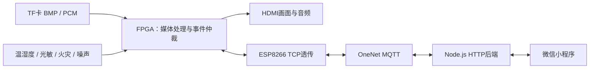

# 智显安播：FPGA商场信息展示与应急广播

广告音视频展示、环境感知、亮度自适应，以及火灾＞寻人＞噪声＞广告的事件仲裁和恢复。FPGA完成设备侧MQTT协议处理，ESP8266负责网络数据传输。

## 目录
- digital_ad_screen：安路HX4S20C / EG4S20BG256 FPGA工程。
- 微信小程序/miniprogram-1-clean：微信小程序前端。
- backend：OneNet HTTP后端与启动配置示例。

## 上传版说明
本仓库由最终代码整理，保留必要IP、RTL与ROM初始化hex，排除编译产物、历史备份与个人配置。未修改本地原工程。

**FPGA的CONNECT_PACKET认证报文已置零，不可直接联网部署。** 使用前在 esp8266_controller.v 中生成并配置自己的MQTT CONNECT报文，同时核对主题中的产品ID和设备名。当前报文宽度及长度固定，改变凭据长度需同步调整，不能只替换字符串。

FPGA源码与工程文件仍含原电脑绝对路径，编译前需将 .al 的Project Path以及RTL中的readmemh路径改为当前目录。详情见 digital_ad_screen/README.md。未执行新的综合或时序验证。

后端配置与启动见 backend/README.md；小程序导入与cpolar连接见其README。小程序原说明中的本机后端路径在此仓库对应 backend 目录。

## 运行顺序
1. 配置FPGA工程路径、媒体资源、自己的设备认证并编译下载。
2. 按引脚约束连接传感器和ESP8266，确认设备可连接OneNet。
3. 配置并启动backend，确认 /health 正常。
4. 导入小程序，填写可访问的后端地址和相同访问口令。

本仓库未另行授予第三方IP授权；第三方IP及工具生成文件的使用须遵循相应授权条款。

## 系统架构

## 功能与硬件

| 功能 | 实现 |
| --- | --- |
| 多媒体展示 | FAT32文件读取、SDRAM帧缓存、800×600 HDMI输出，广告区640×480 |
| 播放控制 | 手动切图、自动轮播、5/10/20/30秒周期、音量与静音 |
| 环境感知 | DHT11温湿度，ADS1115与光敏模块实现亮度自适应 |
| 应急处理 | 火灾、寻人、噪声按优先级抢占，解除后重新仲裁恢复 |
| 远程交互 | OneNet数据流上报、状态查询、远程命令和天气时间同步 |

FPGA端UART TX=L10、RX=M10，ESP8266 EN=P11；DHT11=M14，火灾=N1，噪声=M2，蜂鸣器=H11，ADS1115 SCL=M1、SDA=L1。接线以当前 pin.adc 为准，UART TX/RX需与模块交叉连接。

手机确认报警只停止手机提醒，不解除现场火灾。手机提醒依赖小程序前台及网络连接。当前仓库不提供参数掉电保存；资源和时序以自行编译的实现报告为准。
